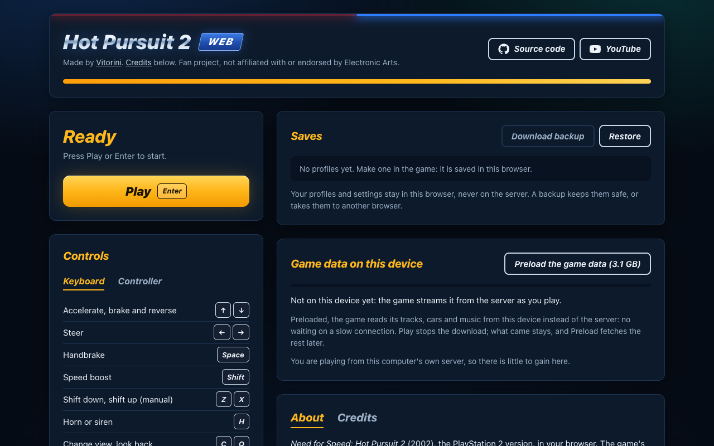

# Need for Speed: Hot Pursuit 2 in the browser

A fan project that runs the PlayStation 2 game *Need for Speed: Hot Pursuit 2* (2002) in Google Chrome and Microsoft Edge.
The game's own code is translated to C++ ahead of time and compiled to WebAssembly. The PS2's graphics run on WebGPU and
the sound on Web Audio. You bring your own copy of the game.

Made by Vitorini ([GitHub](https://github.com/vitorinii), [YouTube](https://www.youtube.com/@v-racer)). Built on
ZloiKILLER's [nfshp2-port-win](https://github.com/ZloiKILLER/nfshp2-port-win), the static recompilation of the game for
Windows; the browser side follows th0mk's [nfsu2-web](https://github.com/th0mk/nfsu2-web).

> Not affiliated with or endorsed by Electronic Arts. This repository contains none of the game's code or data, and none
> of nfshp2-port-win: `setup.sh` fetches it, and this repository's changes to it are a patch.



## What you need

- **The game:** your own disc image (`.iso`) of the USA release, SLUS-20362 (Europe v1.00 has the same program). `setup.sh`
  checks it: the boot program `SLUS_203.62` must have SHA-1 `6397d4425d55056678ed5a405cc81542f7d4d2ee`.
- **To build:** an Apple Silicon Mac (the tested setup) or Linux, with `git`, Python 3, `bsdtar`, `make`, `curl` and
  Node.js 20 or newer. `setup.sh` downloads [wasi-sdk](https://github.com/WebAssembly/wasi-sdk) 34 into `deps/`.
- **To play:** the latest Google Chrome or Microsoft Edge on a computer (WebGPU), with a keyboard or a gamepad; or the latest
  Chrome on an Android phone, with the touch controls on screen.

## Build

```sh
git clone https://github.com/vitorinii/nfshp2-web.git && cd nfshp2-web
./setup.sh "/path/to/SLUS-20362.iso"
```

It copies the game's folder from your disc into `game/`, fetches nfshp2-port-win at the version this repository is made
for and applies `patches/nfshp2-web.patch`, translates the game's program to C++ and compiles it to `build/web/hp2.wasm`.
Run it again after pulling a new version.

The game folder, the generated C++ and the compiled module are made from the game, so they are never committed
(`.gitignore`).

## Play

```sh
./start.sh
```

Open **http://localhost:8080/** in Chrome or Edge and press **Play** (or Enter). The start page has the controls, your
saves and the game data. Keys and buttons can be changed in the game (Options, Controls), and Alt+Enter goes full screen.
Profiles and settings are kept in the browser: **Download backup** saves them as a zip and **Restore** brings one back.
`./start.sh --port 9080` uses another port, `--data <folder>` another game folder.

## How it works

- **`setup.sh`, `patches/`:** nfshp2-port-win's recompiler turns the game's program and its sound driver into C++; the
  patch adds what the browser needs: the PS2's float rounding in software (WebAssembly has no rounding modes), POSIX
  builds, the window and gamepads on the page's input.
- **`runtime/`:** the browser backends of the port's PS2 runtime: frames for WebGPU, the sound ring for the AudioWorklet,
  the page's input block.
- **`web/src/`:** the page. It runs the game's threads as workers on one shared memory, serves its file system from the
  server or the browser's own copy, draws with WebGPU and plays sound through an AudioWorklet.
- **`web/server.mjs`:** the server, with no dependencies: the page, the module and your game folder.

The same tree builds a headless native version for macOS and Linux (`make native`), for debugging. The game's recorded
demo races replay with every checksum matching in both builds.

## Credits

Based on ZloiKILLER's [nfshp2-port-win](https://github.com/ZloiKILLER/nfshp2-port-win): the recompiler, the PS2 runtime
and the PC port this builds on (its `eefloat.h` follows PCSX2's float models). The way to run a recompiled game in the
browser, and the start page's look, follow th0mk's [nfsu2-web](https://github.com/th0mk/nfsu2-web). Compiled with
[wasi-sdk](https://github.com/WebAssembly/wasi-sdk). Built with the help of Claude Code.

## License

MIT ([LICENSE](LICENSE)) for this repository's own files; `patches/nfshp2-web.patch` changes nfshp2-port-win's files,
which stay under their authors' terms. *Need for Speed* and *Hot Pursuit* are trademarks of Electronic Arts Inc.
